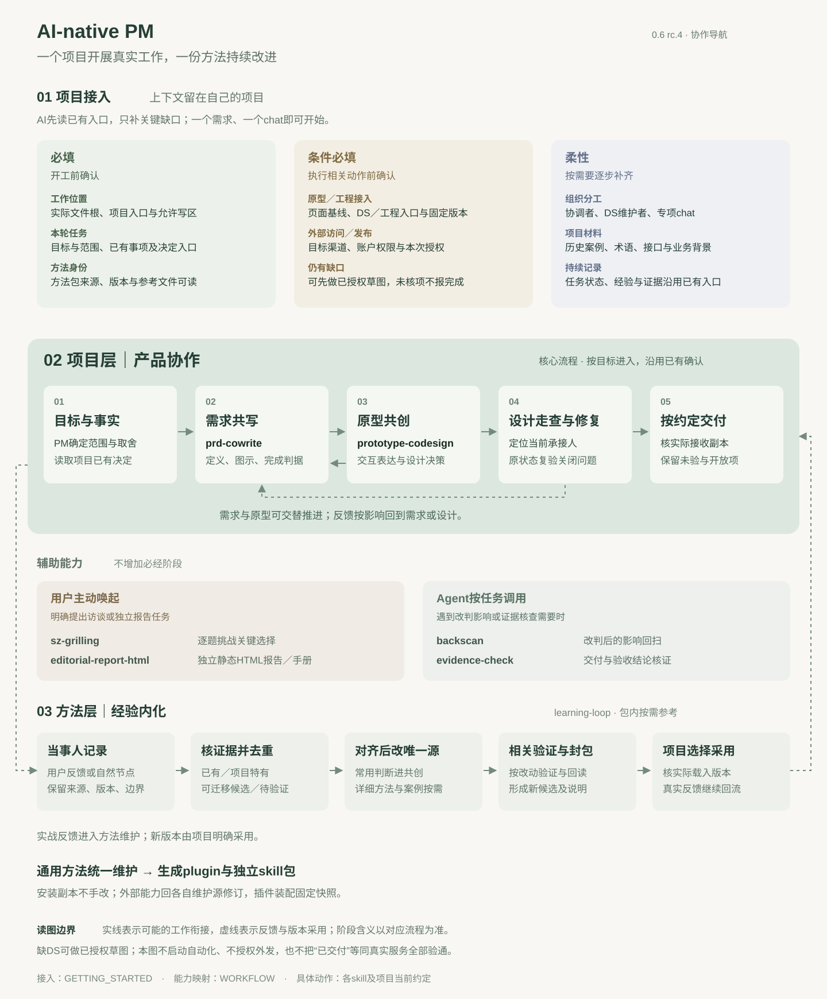

# AI-native PM

面向产品经理的 AI 协作方法包，包含需求共写、原型共创和四项按需能力。

**当前版本 `0.7.0-rc.1` · 公开预发布候选**

从[一个需求开始](plugins/ai-native-pm/GETTING_STARTED.md)，在自己的项目里确认工作位置和权限。按本轮任务选择[需求共写](plugins/ai-native-pm/skills/prd-cowrite/SKILL.md)或[原型共创](plugins/ai-native-pm/skills/prototype-codesign/SKILL.md)。方案需要逐题推敲时用 [sz-grilling](plugins/ai-native-pm/skills/sz-grilling/SKILL.md)，需要独立静态报告时用 [editorial-report-html](plugins/ai-native-pm/skills/editorial-report-html/SKILL.md)，变更影响和交付证据分别用 [backscan](plugins/ai-native-pm/skills/backscan/SKILL.md) 和 [evidence-check](plugins/ai-native-pm/skills/evidence-check/SKILL.md) 核查。

[查看流程与能力映射](plugins/ai-native-pm/WORKFLOW.md) · [执行指令与跨会话交接模板](plugins/ai-native-pm/templates/README.md) · [版本记录](plugins/ai-native-pm/CHANGELOG.md)

## 下载与使用

- [完整插件 ZIP](downloads/ai-native-pm-plugin-0.7.0-rc.1.zip)含六个技能、两份模板和使用指南。
- 按需下载独立技能 ZIP。[backscan](downloads/backscan-skill-0.7.0-rc.1.zip) · [editorial-report-html](downloads/editorial-report-html-skill-0.7.0-rc.1.zip) · [evidence-check](downloads/evidence-check-skill-0.7.0-rc.1.zip) · [prd-cowrite](downloads/prd-cowrite-skill-0.7.0-rc.1.zip) · [prototype-codesign](downloads/prototype-codesign-skill-0.7.0-rc.1.zip) · [sz-grilling](downloads/sz-grilling-skill-0.7.0-rc.1.zip)
- [SHA256SUMS](downloads/SHA256SUMS)可用于核对下载文件。历史版本见 [GitHub Releases](https://github.com/shihao-zhang/ai-native-pm/releases)。

解压后按[安装与回退说明](plugins/ai-native-pm/README.md)操作，或直接让 agent 读取所选技能的 `SKILL.md`。宿主加载、自动触发和真实项目使用待验证。设计系统和工程环境由使用者提供。

方法变更由维护者回流统一维护源。欢迎在公开 Issue 或 PR 中提供可公开的最小复现。详见[发布说明](PUBLISHING.md)、[MIT 许可证](LICENSE)和[上游署名](NOTICE.md)。
