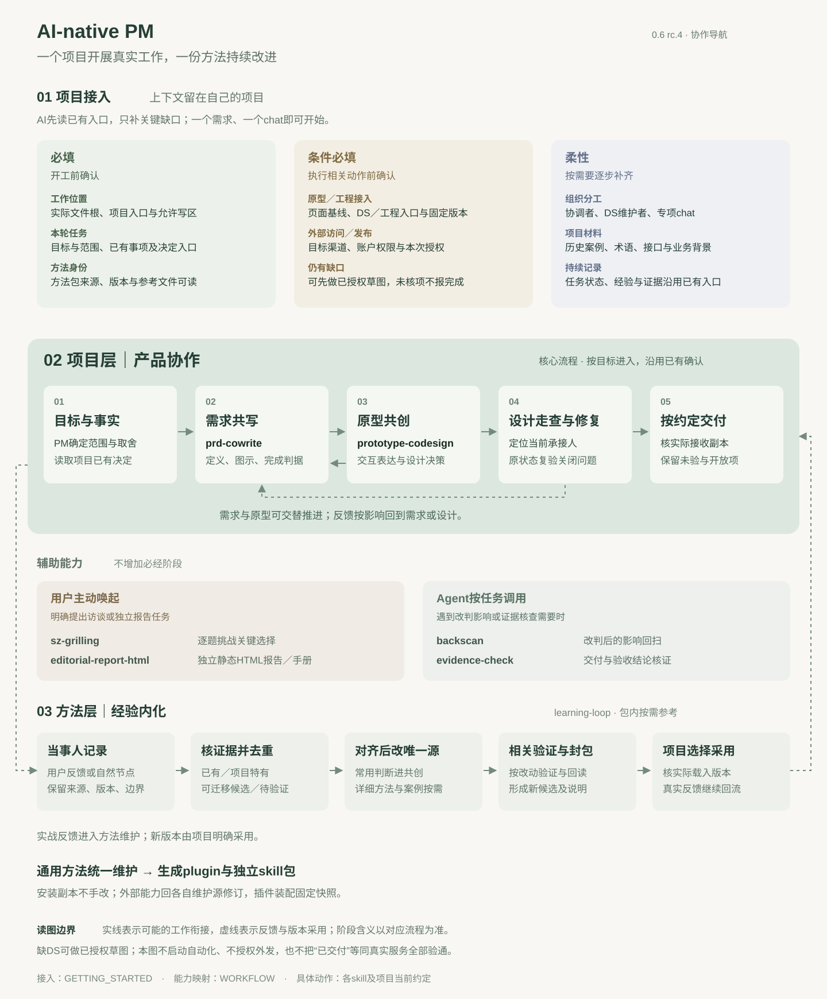

# 协作流程与经验内化

本页是能力导航；按本轮目标进入相关环节，不要求所有需求走完整链路。首次接入见[开始指南](GETTING_STARTED.md)，阶段和权限以对应skill及项目当前约定为准。

## 两层如何相接

**项目层**保存业务事实、需求、确认决定、当前状态、任务写区、DS入口及经验。一个项目可从一个需求chat开始；多需求才按需要设协调者或DS维护者。各会话凭可访问的项目资料衔接，不假设共享完整记忆。

**方法层**维护可复用判断、流程、模板和工具，生成带来源的新plugin版本。项目选择采用版本；经验经核实、去重和授权后才成为方法变更。方法包不自动收取业务材料、不自动升级项目。具体循环见[元方法](references/learning-loop.md)。

## 环节映射到能力

| 这轮要完成什么 | 使用入口 | 人和外部依赖 |
|---|---|---|
| 形成可评审产品定义 | [prd-cowrite](skills/prd-cowrite/SKILL.md) | PM确认目标、范围与取舍，事实来自项目权威材料 |
| 形成可讨论、可对齐的交互表达 | [prototype-codesign](skills/prototype-codesign/SKILL.md) | 产品与设计协作，消费项目有效DS/工程环境 |
| 按已定设计施工或独立走查 | 直接按工单，按需读[走查方法](skills/prototype-codesign/references/design-review.md) | 当前写区维护人承接，未决事项交相应负责人；不因工作量大重启共创 |
| 单独查改判影响 | [backscan](skills/backscan/SKILL.md) | 确认当前定义及检查范围；外部订正另按授权 |
| 单独核交付或验收结论 | [evidence-check](skills/evidence-check/SKILL.md) | 根据对应副本证据判断，未验部分如实保留 |
| 逐题压力测试关键选择 | [sz-grilling](skills/sz-grilling/SKILL.md) | 人明确进入访谈；已确认决定交回本轮任务，访谈不授权实施 |
| 形成独立静态HTML阅读产物 | [editorial-report-html](skills/editorial-report-html/SKILL.md) | 报告／手册的内容与呈现，沿既有事实边界；资料扩展或发布按授权 |
| 首次接入或自然节点经验回流 | [开始指南](GETTING_STARTED.md)／[元方法](references/learning-loop.md) | 使用者选择项目/版本，维护者判断可迁移增量 |

PRD和原型可以交替推进，不要求全文定稿后才画原型。原型阶段唯一含义见[四状态](skills/prototype-codesign/references/workflow.md)；问题的修复进度另留在问题记录，不新增阶段。PM、设计与验收的判断对象不同，谁在何处确认沿项目已有约定，不在图中增设审批门。

决策访谈和静态报告可在需要时进入，不是前置或收尾必经步骤。“把PRD生成HTML”仍走需求共写；“依据PRD另做汇报”可以制作独立派生报告，不能改写产品定义。描述技能、检查技能源文件不等于要求执行它所定义的业务任务。

## 方法与项目各维护什么

共创入口保留常用判断；详细变更影响、术语及证据方法由唯一源生成到需要的skill包，生成副本不手改。两个核查入口可单独使用，日常共创无需先调用它们。术语治理是[按需参考](skills/prd-cowrite/references/terminology.md)，本版没有独立rename-term入口。

决策访谈和静态报告来自独立维护源；plugin按确认版本装配完整快照，来源及文件指纹可查，消费时不依赖作者机器。规则缺陷回上游修正，不在安装包或导入快照中打补丁。

公司DS、业务接口、具体人名和当前交付状态留项目，插件提供[接入方法](skills/prototype-codesign/references/project-context.md)。前后对照案例只说明适用条件；自动压缩、工具可用性、安装后的触发及真实业务效果必须分别验证。
